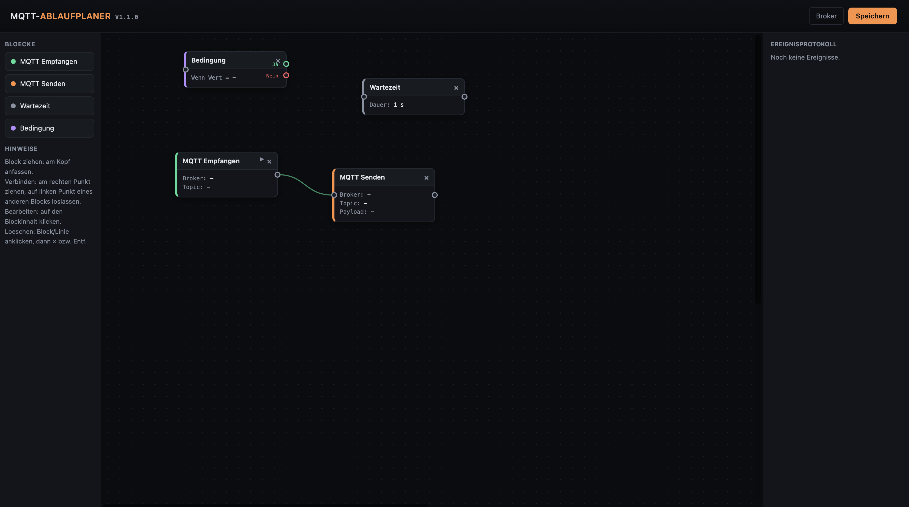

# MQTT-Ablauf- und Verschaltungsplaner



Ein lokal laufendes Web-Tool, um MQTT-gestuetzte Automatisierungen als
Blockschaltbild zu entwerfen - Bloecke werden per Klick auf die
Zeichenflaeche gelegt, per Drag & Drop positioniert und durch Linien zu
einem Ablauf verschaltet (aehnlich Node-RED).

**Aktuelle Version: v1.9.0**

## Bloecke

| Block             | Bedeutung |
|-------------------|-----------|
| **MQTT Empfangen** | Ereignis/Trigger: abonniert ein Topic bei einem Broker, startet den Ablauf bei ankommender Nachricht (optional nur bei exakt passender Payload). |
| **MQTT Senden**     | Aktion: veroeffentlicht eine Nachricht auf einem Topic. `{payload}` im Text wird durch die zuletzt empfangene Nachricht ersetzt, `{payload.feld}` durch ein Feld aus einer JSON-Nachricht (z. B. `{payload.temperature}`, `{payload.sensor.temp}`, Listen: `{payload.werte.0}`). |
| **Wartezeit**       | Pausiert den Ablauf fuer eine einstellbare Dauer - als Festwert oder aus dem Wert eines **Merkers** (Einheit waehlbar: ms, s, min, h; bei ungueltigem Merker-Wert greift ein Ersatzwert). |
| **Merker**          | Speichert einen Wert (Text oder Zahl, wie ein Merker in einer SPS). Laeuft ein Ablauf in den Block, wird seine Aktion ausgefuehrt: setzen (mit `{payload}` bzw. `{payload.feld}`), **empfangenen Wert speichern** (ganze Nachricht oder ein JSON-Feld), umschalten (0/1), hoch-/herunterzaehlen oder auf den Startwert zuruecksetzen. |
| **UND**             | Eigenstaendig: beliebig viele Eingaenge, ein Ausgang. Jeder Block (Bedingung, Merker, MQTT Empfangen, Wetter, Rechnen, UND/ODER) laesst sich direkt anschliessen - eine Bedingung ist nicht noetig. Der Ausgang loest aus, wenn **alle** Eingaenge Ja ergeben; geprueft wird, sobald ueber eine Linie ein Ablauf ankommt. "Ja" bedeutet: Bedingung erfuellt, Merker bzw. Nachricht wahr (`1`, `true`, `on`, Zahl ungleich 0), Wetter trifft zu. Optional loest der Ausgang immer aus (Nachricht `1` = Ja, `0` = Nein). |
| **ODER**            | Wie UND, aber der Ausgang loest aus, sobald **mindestens ein** Eingang Ja ergibt. |
| **Rechnen**         | Verrechnet die Werte von zwei oder mehr Eingaengen: `+`, `-`, `*`, `/`, Rest, Potenz, Minimum, Maximum, Mittelwert (bei nur einem Eingang mit einer Konstanten). Optional auf 0-6 Nachkommastellen gerundet. Das Ergebnis laeuft als Nachricht weiter (in "MQTT Senden" als `{payload}`) und steht anderen Bloecken als Wert bereit (Merker, Bedingung, weiteres Rechnen). Division durch 0 oder ein Nicht-Zahlenwert beendet den Zweig und steht im Ereignisprotokoll. |
| **Bedingung**       | Zwei oder mehr Eingaenge, zwei Ausgaenge (Ja/Nein). Standardtyp **Eingaenge vergleichen**: Die Werte der angeschlossenen Bloecke (MQTT Empfangen = letzte Nachricht, Merker, Rechnen, Wetter ...) werden verglichen - zwei Eingaenge `A > B`, bei nur einem Eingang mit einem Vergleichswert, bei mehr Eingaengen muss der Vergleich fuer jedes aufeinanderfolgende Paar gelten (`A < B < C`). Weitere Typen: **Nachrichteninhalt** (`=`, `≠`, "enthaelt", `>`, `<`), **Uhrzeit** (zwischen/ab/vor, auch ueber Mitternacht), **Sonne aufgegangen/untergegangen** (optional mit Minuten-Versatz), **Wochentag** (Mehrfachauswahl), **Datum** (einzeln oder Zeitraum, optional jaehrlich wiederkehrend) und **Merker** (Vergleich mit dem aktuellen Merker-Wert: `=`, `≠`, `>`, `≥`, `<`, `≤`, "enthaelt", "ist wahr/falsch"). |

Bedienung:
- **Block platzieren:** links in der Palette anklicken.
- **Verschieben:** am Blockkopf ziehen.
- **Mehrere Bloecke:** auf leerer Flaeche einen Rahmen aufziehen - alle beruehrten
  Bloecke werden markiert und lassen sich gemeinsam am Kopf eines markierten Blocks
  verschieben. Umschalt/Strg + Klick auf einen Blockkopf fuegt einen Block zur Auswahl
  hinzu bzw. entfernt ihn (auch beim Rahmenziehen: bisherige Auswahl bleibt erhalten),
  Strg+A waehlt alle, Esc hebt die Auswahl auf, Entf loescht alle markierten Bloecke.
- **Verbinden:** am rechten Punkt (Ausgang) ziehen und auf dem linken
  Punkt (Eingang) eines anderen Blocks loslassen.
- **Bearbeiten:** auf den Blockinhalt klicken.
- **Loeschen:** Block oder Linie anklicken, dann auf `×` bzw. Entf-Taste.
- **Testen:** ein "MQTT Empfangen"-Block hat einen kleinen ▶-Knopf, der
  ein Ereignis simuliert, ohne auf eine echte Nachricht zu warten; ein
  "MQTT Senden"-Block hat im Bearbeiten-Dialog einen "Jetzt senden
  (Test)"-Knopf.

**Merker:** Der aktuelle Wert wird live im Block angezeigt; mit dem ✎-Knopf laesst er sich von Hand setzen (z. B. zum Testen). Wird der Startwert im Dialog geaendert, gilt er sofort. Mit der Option "Wert nach einem Neustart behalten" wird der Wert in `markers.json` (neben `config.json`) gespeichert - bei sehr haeufigen Aenderungen (mehrmals pro Sekunde) besser nicht remanent verwenden, um den Speicher des Geraets zu schonen. Wahr sind die Werte `1`, `true`, `on`, `an`, `ein`, `ja`, `yes`, `wahr`.

**Linien:** Jede Linie (rechter Ausgang -> linker Eingang) traegt Ablauf **und** Wert und darf zwischen beliebigen Bloecken gezogen werden. An **Bedingung**, **UND**, **ODER** und **Rechnen** koennen beliebig viele Linien enden; bei Bedingung und Rechnen stehen die Eingangsbuchstaben A, B, C ... an den Linien (Reihenfolge = Reihenfolge des Ziehens, im Dialog per "Eingaenge tauschen" aenderbar). Kommt ein Ablauf ueber eine Linie an, liest der Block die aktuellen Werte aller seiner Eingaenge (zuletzt empfangene Nachricht, Merker-Wert, Rechenergebnis ...); ein Eingang ohne bisherigen Wert beendet den Zweig mit einem Hinweis im Ereignisprotokoll. Ein **Merker** hat Ein- **und** Ausgang und laesst sich ueberall anschliessen: als Ziel (setzen, speichern ...) und als Eingang (sein Wert). Wertet eine Bedingung oder Wartezeit einen Merker ueber den Dialog aus, zeichnet das Programm weiterhin automatisch eine gestrichelte, hellblaue Linie. Das Ereignisprotokoll nennt je Eingang den Wert bzw. Ja/Nein; die Ablaufanzeige schickt bei jedem gelesenen Eingang einen blauen (Wert) bzw. gruenen/roten (Ja/Nein) Punkt ueber die Linie.

**Umstieg von aelteren Dateien (bis v1.8.0):** Alte Datenlinien werden beim Laden automatisch in normale Eingangs-Linien umgewandelt; Linien, die nur den Ablauf in ein UND/ODER fuehrten, bleiben als reine Ausloeser (gepunktet) erhalten. UND/ODER haben jetzt nur noch einen Ausgang: der frueher vorhandene "Nein"-Ausgang entfaellt (daran haengende Linien werden entfernt), "Ja" wird zum einzigen Ausgang.

**Beispiel - Temperatur merken und spaeter vergleichen:** Ein "MQTT Empfangen"-Block auf dem Temperatur-Topic wird mit einem Merker "Temperatur" verbunden (Aktion: *Empfangenen Wert speichern*, JSON-Feld z. B. `temperature`, bei einer reinen Zahl als Nachricht das Feld leer lassen). Ein zweiter "MQTT Empfangen"-Block auf einem anderen Topic fuehrt in eine **Bedingung** vom Typ *Merker* (`Temperatur > 20`); ueber "Ja"/"Nein" geht es zu den Aktionen. Der Merker haelt den letzten Wert, bis eine neue Nachricht kommt. Startwert leer = noch kein Wert (Zahlenvergleiche ergeben dann "Nein"). Kann das Feld nicht gelesen werden (kein JSON, Feld fehlt), bleibt der alte Wert erhalten, der Zweig endet, und das Ereignisprotokoll nennt den Grund.

**Merker anklicken:** Der Dialog zeigt den aktuellen Wert live und erlaubt, ihn mit "Jetzt setzen" sofort zu aendern.

**Seiten:** Ueber die Reiter oberhalb der Flaeche lassen sich mehrere Seiten anlegen (+), per Doppelklick umbenennen und per x loeschen. Jede Seite hat eigene Elemente und Linien; Linien gehen nur innerhalb einer Seite. **Merker gelten auf allen Seiten** - so koennen Seiten ueber Merker miteinander arbeiten (Bedingungen und Wartezeiten zeigen dann den Seitennamen des Merkers, die automatische Merker-Linie wird nur auf derselben Seite gezeichnet). "Auswahl verschieben" bringt markierte Elemente auf eine andere Seite (Linien zu Elementen, die zurueckbleiben, werden getrennt). Die zuletzt geoeffnete Seite wird im Browser gemerkt. Abgelaufen werden alle Seiten gemeinsam.

**Flaeche:** Die Arbeitsflaeche ist 6000 x 4000 Pixel gross und waechst automatisch mit, wenn Elemente weiter aussen liegen. Beim Ziehen am Rand scrollt sie mit.

**Ablaufanzeige:** Laeuft ein Ablauf, wandert ein kleiner Punkt (mit dem Namen des Ziel-Blocks) ueber die Linie; der gerade aktive Block leuchtet orange (bei einer Wartezeit, solange sie laeuft) und zeigt danach kurz sein Ergebnis (gruen = weiter/Ja, rot = Nein, grau = Zweig beendet). Bei UND/ODER laufen die Eingaenge als gruene (Ja) bzw. rote (Nein) Punkte ueber die Datenlinien, Merker-Zugriffe als blaue Punkte ueber die Merker-Linien. Ein Ablauf auf einer anderen Seite laesst deren Reiter aufblinken. Die Anzeige laeuft bewusst etwas langsamer als der echte Ablauf, damit man ihr folgen kann.

**Wetter (Internet):** Das aktuelle Wetter am eingestellten Standort kommt von [Open-Meteo](https://open-meteo.com) (kein Schluessel noetig, nur fuer nicht-kommerzielle Nutzung). Es gibt zwei Einsatzarten:
- **Bedingung** vom Typ *Wetter (Internet)*: z. B. `Temperatur > 25` oder `Wetterlage ist Regen` - danach geht es ueber "Ja"/"Nein" weiter (Rolladen runter, wenn es heisser als 25 Grad ist).
- **Ausloeser** "Wetter (Ausloeser)": startet einen Ablauf von selbst. Modus *Beim Zutreffen* (nur beim Wechsel von "nein" auf "ja"), *Bei jeder Aenderung* oder *Solange zutreffend* (bei jeder Abfrage); optional schon beim Programmstart. Beispiel: es regnet -> Licht an.
Der Standort kann als Stadtname eingegeben werden. Messwerte: Temperatur, gefuehlte Temperatur, Luftfeuchte, Wind, Windboeen, Niederschlag, Bewoelkung sowie Wetterlagen (Regen, Schnee, Gewitter, Nebel, klar, bewoelkt). Abfrageintervall 5-120 Minuten (Standard 10) im Dialog "Standort & Wetter"; der Knopf "Wetter" zeigt die aktuellen Werte. Bei Internetausfall werden die letzten Werte bis zu einer Stunde weiterverwendet, danach ergibt die Bedingung "Nein" und das Ereignisprotokoll nennt den Fehler. Hinweis: Es gibt keine Hysterese - schwankt ein Wert um die Schwelle, kann ein Ausloeser mehrfach feuern.

Fuer die Sonnen-Bedingung den **Standort** (Knopf oben rechts) einstellen - entweder per **Stadtname** (Feld "Stadt oder Ort" + "Suchen", bei mehreren Treffern den passenden auswaehlen; die Ortssuche nutzt Open-Meteo und braucht Internet) oder mit Koordinaten von Hand - Auf-/Untergang werden lokal berechnet (keine Internetverbindung noetig). Uhrzeit, Wochentag, Datum und Sonne verwenden die **Zeitzone des Rechners/Routers**.

Alle Broker, Bloecke und Verbindungen werden lesbar in `config.json`
gespeichert (liegt neben dem Skript bzw. der exe/App) und koennen bei
Bedarf auch von Hand angepasst werden.

## Lokal starten (Entwicklung)

```bash
pip install -r requirements.txt
python app.py
```

Danach im Browser: `http://127.0.0.1:8020` (im lokalen Netz erreichbar
ueber die IP des Rechners).

## Installation auf einem GL.iNet-Router (z. B. Brume 2)

Der Brume 2 und aehnliche GL.iNet-Geraete laufen auf OpenWrt
(ARM64/musl-libc) - die fertigen Windows-/macOS-Dateien passen dort
nicht, das Programm laesst sich dort aber direkt als Python-Skript
betreiben. Schritt-fuer-Schritt-Anleitung: [ANLEITUNG-GLiNet-Brume2.md](ANLEITUNG-GLiNet-Brume2.md).

## Als GitHub-Repo einrichten

```bash
git init
git add .
git commit -m "Initial commit: MQTT-Ablaufplaner v1.0.0"
git branch -M main
git remote add origin <URL-DEINES-LEEREN-REPOS>
git push -u origin main
```

Der Workflow unter `.github/workflows/build.yml` startet danach
automatisch bei jedem Push auf `main` (und kann zusaetzlich manuell im
Tab "Actions" ueber "Run workflow" ausgeloest werden) und baut:

- eine **Windows-EXE** (`MQTT-Ablaufplaner-vX.Y.Z-windows.exe`) - startet
  immer mit sichtbarem Konsolenfenster.
- ein **macOS-Paket fuer Apple Silicon** (`MQTT-Ablaufplaner-vX.Y.Z-macos-arm64.zip`,
  gebaut nativ auf einem `macos-14`-Runner mit `--target-arch arm64`),
  bestehend aus der Programmdatei `MQTT-Ablaufplaner` und einem
  Start-Skript `Start-MQTT-Ablaufplaner.command`.

Beide Dateien findest du danach im jeweiligen Workflow-Lauf unter
"Artifacts".

### Programm starten/beenden

Das Programm startet bewusst immer mit einem sichtbaren
Terminal-/Konsolenfenster, in dem der Serverstatus zu sehen ist - so
laesst es sich jederzeit einfach wieder beenden:

- **Windows:** `MQTT-Ablaufplaner-....exe` doppelklicken - es oeffnet
  sich ein Konsolenfenster. Zum Beenden das Fenster schliessen oder
  darin STRG+C druecken.
- **macOS:** die Datei `Start-MQTT-Ablaufplaner.command` doppelklicken
  (nicht die Programmdatei `MQTT-Ablaufplaner` selbst) - der Finder
  oeffnet dafuer automatisch ein Terminal-Fenster. Zum Beenden das
  Terminal-Fenster schliessen (mit "Beenden" bestaetigen) oder STRG+C
  druecken. Beide Dateien muessen dabei im selben Ordner liegen.

### Ein Release mit fertigen Downloads erzeugen

Sobald du einen Tag im Format `vX.Y.Z` push, erstellt der Workflow
zusaetzlich automatisch ein GitHub-Release mit beiden Dateien im Anhang:

```bash
git tag v1.0.0
git push origin v1.0.0
```

Wichtig: Die Versionsnummer im Tag sollte zu `APP_VERSION` in `app.py`
passen (Zeile ganz oben in der Datei) - der Workflow liest die Version
per Regex direkt aus dieser Konstante fuer die Dateinamen und den
Release-Titel aus.

### Hinweis zu unsignierten Dateien

Die gebauten Dateien sind nicht signiert/notarisiert:
- **Windows** zeigt beim ersten Start ggf. eine SmartScreen-Warnung
  ("Weitere Informationen" -> "Trotzdem ausfuehren").
- **macOS** kann die Programmdatei beim ersten Start als "nicht
  verifizierter Entwickler" blockieren. Falls das passiert: im Finder
  mit Rechtsklick auf `MQTT-Ablaufplaner` -> "Oeffnen" bestaetigen
  (nur einmalig noetig), oder im Terminal im entpackten Ordner
  `xattr -cr .` ausfuehren, um das Quarantaene-Flag zu entfernen.

## Bei jeder Aenderung

1. `APP_VERSION` in `app.py` erhoehen (Semantic Versioning: PATCH fuer
   Bugfixes, MINOR fuer neue, abwaertskompatible Funktionen, MAJOR fuer
   Breaking Changes am Config-Format).
2. Aenderung committen, pushen.
3. Optional: passenden Tag `vX.Y.Z` push, um automatisch ein Release
   mit den gebauten Dateien zu erzeugen.
